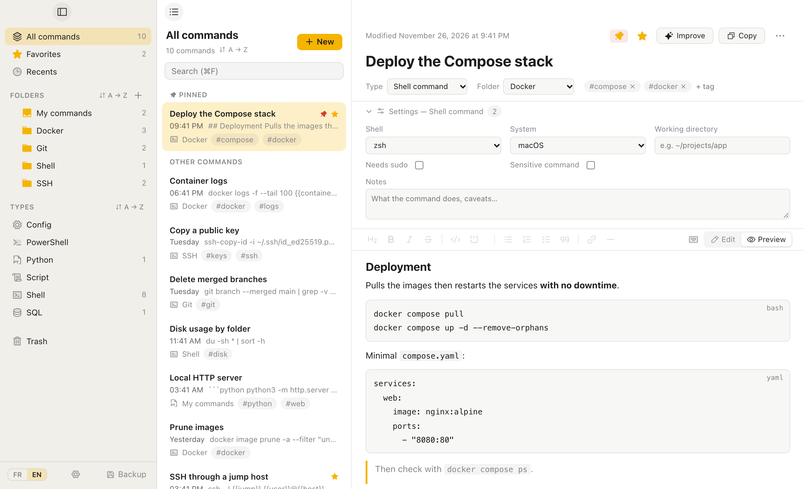

# Emmanuel ROMAIN - 2026
# Pulse-ware

# Tips Commands

🇫🇷 [Lire en français](LISEZ-MOI.md)

A command manager for macOS in the spirit of Apple Notes: keep and organize your shell, Docker, SSH, Git… commands in a folder tree, a list and an editor.
A lightweight native app (Tauri 2: Rust core + React interface) that stores your data **locally** in SQLite.

<p align="center"></p>

## Features

- Nested **folders**: “My commands” (the default folder, which cannot be deleted) plus **Shell**, **Docker**, **SSH**
  and **Git**, created on first launch — rename, delete or add as many folders and sub-folders as you like.
- **Sorting**: folders, types, the command list and drop-down menus are sorted **alphabetically** by default
  (case and accents ignored, numbers in natural order: 2 before 10). The ⇅ button of each section switches to
  Z → A, date modified (list) or **manual** order: drag items to place them, the order is remembered.
  “My commands” and pinned commands stay on top; “Recent” stays chronological.
- **Type** of each command: shell command, shell script, SQL query, Python, PowerShell, configuration file — with
  **type-specific settings** (shell, OS, needs sudo, sensitive command, SQL engine, file format, notes…).
- **Markdown** content with a formatting toolbar and shortcuts (heading ⇧⌘H, bold ⌘B, italic ⌘I, inline code ⌘E,
  code block ⌥⌘C, lists ⇧⌘8 / ⇧⌘7 / ⇧⌘L, quote ⇧⌘9, link ⌘K) and an **Edit / Preview** switch (⇧⌘P).
  When a note contains ```` ``` ```` code blocks, **Copy** and the palette take only those blocks — ready for the Terminal;
  each block also has its own Copy button in the preview.
- **Code blocks in several languages**: the ⌄ menu next to the code-block button (or ⌥⌘1…6) inserts a Bash, Python,
  JavaScript, YAML, JSON or SQL block; with the cursor inside an existing block it changes that block's language,
  shown as a badge in the preview.
- **Editing shortcuts**: type `` ` `` `"` `'` `(` `)` `[` `]` `{` `}` on a selection to surround it (`example`), ⇥ / ⇧⇥ indent
  (4 spaces in Python, 2 otherwise), Enter keeps the indentation inside a block (and adds one after `:` in Python / YAML),
  ⌥↑ / ⌥↓ move lines, ⇧⌘D duplicates, ⌘/ comments with the block's marker (`#`, `//`, `--`). The ⌨ button lists them all.
- **Variables** `{{host}}`: a form fills them in and copies the completed command (`ssh {{user}}@{{host}}`).
  Go templates used by Docker or kubectl (`{{.Names}}`, `{{json .}}`) are left untouched.
- **Tags** sorted alphabetically, with autocompletion (docker, git, ssh, rsync, kubectl, brew…).
- Favorites, **pinning** (pinned commands stay at the top of the list), trash (30 days), version history.
- Instant search (name, content, tags), drag and drop for commands and folders.
- **Global palette** `⌥⌘P`: search a command and paste it straight into the Terminal (or any application).
- **AI assistance** (Claude or Gemini): improve, fix, simplify, comment, split over several lines,
  make portable between macOS and Linux, make safer.
- **Markdown**, **CSV** and **JSON** export (full backup); JSON import.
- **French** and **English** interface (follows the Mac's language by default; switchable at the bottom of the sidebar).
- Automatic light/dark theme.

## Requirements

| Tool | Tested version | Installation |
|---|---|---|
| macOS | 26 (Apple Silicon) | — |
| Xcode Command Line Tools | — | `xcode-select --install` (full Xcode is **not** required) |
| Node.js + npm | 24 / 11 | <https://nodejs.org> |
| Rust (via rustup) | 1.97 | <https://rustup.rs> |

## Getting started

```bash
cd "Tips Commands"
npm install
npm run tauri dev
```

The first Rust build takes a few minutes; later ones are fast. The frontend hot-reloads and the Rust core
recompiles automatically on every change.

| Command | Purpose |
|---|---|
| `npm run tauri dev` | Native app (real SQLite, palette, Keychain) |
| `npm run dev` | Interface only, in a browser, with an **in-memory mock backend** (`src/dev-mock.ts`) — handy for testing the UI, no persistence |
| `npm run build` | TypeScript check + frontend build |
| `cd src-tauri && cargo test --lib` | Rust core tests |
| `npm run tauri build -- --bundles app` | Builds `Tips Commands.app` (~7 MB) in `src-tauri/target/release/bundle/macos/` |

The built application is located at `src-tauri/target/release/bundle/macos/Tips Commands.app`.

It is **not signed**: on first launch, right-click ▸ **Open** (Gatekeeper).

## Usage

### Keyboard shortcuts

| Shortcut | Action |
|---|---|
| `⌘N` / `⇧⌘N` | New command / new folder |
| `⌘F` | Search |
| `⌥⌘S` / `⌥⌘L` | Collapse the sidebar / the command list |
| `⌥⌘P` | Global palette (from any application) |

In the palette: `↑` `↓` to navigate, `↵` to paste, `⌘↵` to copy only, `Esc` to close.

Closing the main window **hides** it so the palette stays available; `⌘Q` quits, and clicking the Dock icon
reopens it.

### macOS permissions

- **Accessibility** (System Settings ▸ Privacy & Security ▸ Accessibility): required for the palette to **paste**
  (`⌘V`) automatically into the previous application. Without it, the prompt is simply left in the clipboard.
- **Automation** (System Events): requested the first time you paste.
- **Keychain**: requested the first time you save an AI key.

### AI improvement

1. Open **Settings** (gear icon at the bottom of the sidebar).
2. Choose **Claude** or **Gemini**, paste your API key, then click **Test connection**.
3. In the editor, click **Improve**.

Keys are stored in the **macOS Keychain**, never in the database or in a file. The command text is sent to the
provider you choose. Get a key: <https://console.anthropic.com> (Claude) · <https://aistudio.google.com/apikey> (Gemini).
The default models can be changed in the settings (model identifiers evolve).

### About

**Tips Commands ▸ About Tips Commands** (application menu), or **Settings ▸ About Tips Commands…**: author, company and version number.

### Data

SQLite database: `~/Library/Application Support/com.pulseware.tipscommands/tipscommands.db`.
Back it up with **Backup ▸ Export library (JSON)**. To start from scratch, quit the app and delete this file.

## Project structure

```
Tips Commands/
├── src/                  React + TypeScript interface
│   ├── assets/           App icon and Pulse-Ware logo
│   ├── components/       Sidebar, PromptList, Editor, Palette, AiPanel, SettingsDialog, AboutDialog…
│   ├── i18n/             fr.ts / en.ts dictionaries (same keys, enforced by the type system)
│   ├── dev-mock.ts       Mock backend (browser only)
│   └── styles.css
├── src-tauri/            Rust core
│   ├── icons/            Application icons (generated from the app icon)
│   └── src/
│       ├── store.rs      SQLite: schema, migrations, FTS5 search, versions, exports
│       ├── commands.rs   Tauri commands exposed to the interface
│       ├── palette.rs    Global shortcut and floating window
│       └── ai.rs         Claude / Gemini, macOS Keychain
├── docs/                 Screenshots used in the READMEs (EN / FR)
├── LICENSE               GNU AGPL-3.0
└── README.md / LISEZ-MOI.md   Documentation (English / French)
```

`Tips Commands.app`, next to the project folder, is a ready-to-use copy of the application: drag it into `/Applications`
(it is **not signed**: right-click ▸ **Open** the first time). To build a fresh one yourself, see
[Getting started](#getting-started).

## Troubleshooting

| Symptom | What to try |
|---|---|
| `Port 1420 is already in use` | Another `tauri dev` / `vite` is running: `pkill -f vite`, or close the old one |
| `⌥⌘P` does nothing | Another app already uses this shortcut; check the `tauri dev` console |
| The palette copies but does not paste | Allow Tips Commands under Privacy & Security ▸ **Accessibility** |
| “API key rejected” error | The key is invalid or lacks permissions; save it again in Settings |
| `cargo`: error about `serde` | After editing `Cargo.toml`, run `cargo build` (not just `cargo test`) |
| `cargo`: `linking with cc failed` / `tapi error: malformed file … unknown architecture` | The default macOS SDK is newer than the linker: update the Command Line Tools (`softwareupdate --list`), or build against an older SDK, e.g. `SDKROOT=/Library/Developer/CommandLineTools/SDKs/MacOSX26.5.sdk npm run tauri dev` |
| `cargo`: `failed to read plugin permissions … No such file or directory` | The project folder was moved and `target/` still points to the old path: `cd src-tauri && cargo clean` |

## Google Drive — creating the OAuth client ID

> **Google Drive sync is not implemented yet.** This guide prepares the credentials it will need; the app will ask
> for them in Settings once the feature ships. Google's interface changes over time: the labels below may differ
> slightly.

The app will only request the `https://www.googleapis.com/auth/drive.appdata` scope: a **hidden space reserved for
Tips Commands** in your Drive. It can neither see nor modify **any** of your other files.

1. **Create a project.** Open the [Google Cloud console](https://console.cloud.google.com), then the project picker
   ▸ **New project** (for example “Tips Commands”).
2. **Enable the Drive API.** *APIs & Services ▸ Library* ▸ search for **Google Drive API** ▸ **Enable**.
3. **Configure the consent screen.** 
     *APIs & Services ▸ OAuth consent screen* (or *Google Auth Platform*):
   - User type: **External**; fill in the app name and your support email.
   - *Data access* (Scopes): add `.../auth/drive.appdata`.
   - While the app is in **Testing** mode, add your Google account under **Test users** — otherwise sign-in is refused.
4. **Create the credentials.** *APIs & Services ▸ Credentials ▸ Create credentials ▸ OAuth client ID*:
   - Application type: **Desktop app**.
   - Name: “Tips Commands”. Confirm.
5. **Collect the values.** Note the **Client ID** and the **Client secret** (or download the JSON). For a desktop app
   this secret is not confidential in the strict sense, but do not publish it anyway.
6. **Enter them in Tips Commands** (once the feature ships): *Settings ▸ Google Drive*, paste the Client ID and the
   secret. They will be stored in the macOS Keychain, like the AI keys. Sign-in opens in your browser and returns to a
   local address (`http://127.0.0.1`), with nothing more to configure.

Good to know:

- In **Testing** mode, Google expires the authorization after **7 days**: you will have to sign in again every week.
  To avoid this, switch the consent screen to **In production** (*Publish app*). For personal use, Google may show
  “unverified app”: *Advanced ▸ Continue*.
- **Never commit** the Client ID / secret to a repository.
- Revoke access: <https://myaccount.google.com/permissions>.

## Uninstalling

Delete `Tips Commands.app`, then make sure this folder is empty or removed:
`~/Library/Application Support/com.pulseware.tipscommands/`

## License

<p></p>

Emmanuel ROMAIN - 2026  
Pulse-Ware

GNU AGPL-3.0 — see [`LICENSE`](LICENSE).
